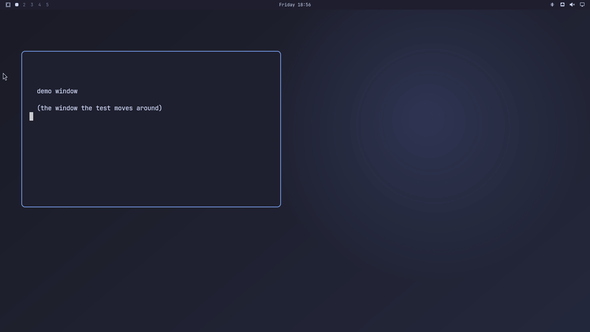
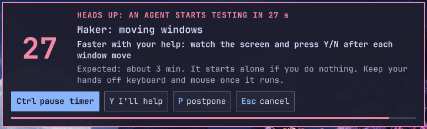
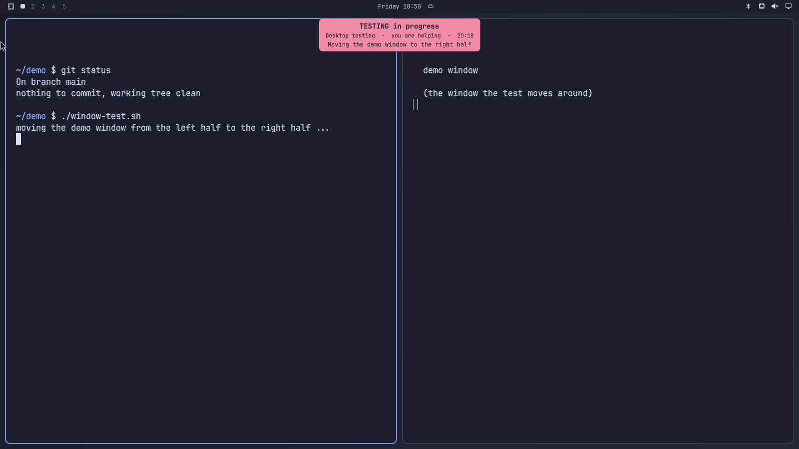
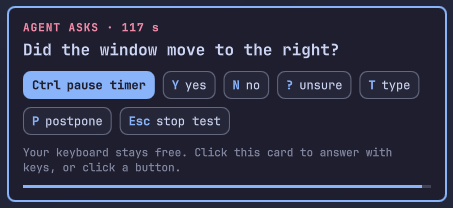
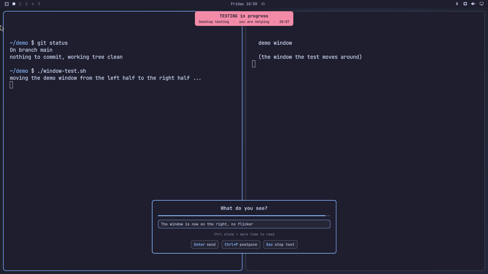
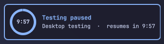

# Agent Handshake



Omarchy shell plugin for working with AI agents. An agent tells you when it needs the hardware you also feel: your screen, keyboard and mouse, a heavy CPU/RAM job, a VM with lots of resources, the GPU. Before an agent tests on your desktop (moving windows, workspaces, the bar, animations, opening apps) it tells you with a countdown and a TESTING badge, so your clicks do not spoil its test and its test does not spoil your work. While it runs it can ask you quick questions (Ctrl+Y / Ctrl+N / Ctrl+/ or a typed reply) instead of slow screenshot loops. Works with any agent: Claude Code, Codex, Gemini CLI, OpenCode and others.

<a href='https://ko-fi.com/akton1' target='_blank'></a>

## What's new
- **0.4.0 (2026-10-18):** agents announce the hardware they need. `talk-to-me need cpu|vm|gpu "<what and why>" --estimate 10m` before a heavy CPU/RAM job, a VM with lots of resources or heavy GPU use, `talk-to-me release ...` after; a pill at the bottom right of every screen shows who uses what and for how long. The screen, keyboard and mouse stay `talk-to-me start`. New bar icon (a small chip) with the current holders, a Release button per entry and every setting of the plugin. Optional queue (`hw-queue`): the next agent waits in line instead of sharing the resource. Optional enforcement (`hw-enforce`): the guard hook blocks known heavy commands (`ollama run`, `vm-test`, `stress-ng`, big encodes) until they are announced.
- **0.3.8 (2026-10-15):** titles, questions, help and status lines are shown in full (wrapped over several lines, up to 240 characters for the title) instead of cut off. `talk-to-me start` now needs a real title (who, what exactly, for which project or reason, 5+ words); "Desktop testing" or "demo" are refused with exit 2 so you always know what is being tested.
- **0.3.7 (2026-10-15):** the typed-answer box no longer uses Qt's built-in text input, which reads the clipboard by itself whenever another program changes it. It is drawn by the plugin now (`PlainField.qml`) and never touches the clipboard on its own. Typing, selecting, Enter and Ctrl+Q work as before. Ctrl+V and Shift+Insert paste through a separate `wl-paste` process (2-second deadline, size limit); middle click does not paste.
- **0.3.6 (2026-10-14):** every card hotkey now needs Ctrl (Ctrl+Y yes, Ctrl+N no, Ctrl+/ unsure, Ctrl+T type, Ctrl+P postpone, Ctrl+Q stop or cancel, Ctrl+Enter start now; Enter still sends in the typing box), so stray letters while you type can never answer anything. A paused card (tap Ctrl) shrinks and sits at the right edge. Agents are told to check for a VM first.
- **0.3.5 (2026-10-14):** the typed-answer box no longer exists until you open it, and it ignores paste (Ctrl+V, Shift+Insert, middle click), so a clipboard owner can never make the shell read an unbounded clipboard.
- **0.3.4 (2026-10-13):** a postponed test stays postponed. If an agent runs `talk-to-me start` again before your pause is over (a retry, or a second agent), it now gets `postpone:<minutes left>` at once instead of starting a new countdown.
- **0.3.3 (2026-10-13):** while the agent works, every screen switches to an empty workspace, so none of your windows are in the way or stuck on screen. Nothing is moved or closed; everything comes back when the session ends. Switch it off with `talk-to-me settings set hide off`, or per test with `--no-hide`.
- **0.3.2 (2026-10-12):** `talk-to-me start "Claude Code: restarting the Omarchy shell to load the updated Ask Me While Testing plugin" --work` for non-test desktop work (shell restart, plugin install): the screens say WORKING instead of TESTING. The agent installer now writes your agent settings and their backup with private permissions from the start.
- **0.3.1 (2026-10-09):** a green DONE checkmark card when the agent finishes a test.
- **0.3.0 (2026-10-09):** an agent watcher for any agent, a mouse shield while the agent works alone, an estimate shown for the whole test.

## Why you want this
AI agents that build or tweak your Omarchy desktop (plugins, Hyprland config, bar, animations, games) cannot see what you see. Screenshot loops are slow and often wrong, and an agent that suddenly opens windows or sends keys while you work spoils its own test: a stray click of yours looks like a failed test. This plugin gives you and the agent a short handshake:

- **You know when it starts, and about how long it takes.** A countdown and an always-visible TESTING banner say "hands off the mouse and keyboard now". The agent gives an estimate (`--estimate 3m`): the card shows "Expected duration: about 3 min", the banner keeps showing "Expected 3 min · about 2:10 left" for the whole test and says "taking longer" when it overruns. You can postpone (Ctrl+P) or cancel (Ctrl+Q).
- **The agent gets your eyes.** One key combo (Ctrl+Y / Ctrl+N / Ctrl+/) or a typed reply answers "did the window move?" in seconds, instead of a screenshot round trip.
- **It cannot forget.** A guard hook makes the agent start a session before it touches your desktop (see "Which commands are guarded").

### Only when you or the test could disturb each other
**Check for a VM first.** Before anything else, check whether the test can run in a virtual machine (or a nested compositor) instead of on the human's real desktop. If it does not need their real logins, GPU or monitors, run it there: no session, no banner, no risk. Only start a session for what truly needs the real desktop.

A session (countdown + banner) is for work that uses **your** screen, keyboard or mouse: the test needs your display or input focus, or your clicks would spoil it, or it moves your windows. Work that cannot touch you needs none: files and code, `--headless` runs, a **nested compositor on a virtual `HEADLESS-n` monitor** (screenshots of a scratch desktop), commands aimed at another compositor (their own `HYPRLAND_INSTANCE_SIGNATURE` / `WAYLAND_DISPLAY`). The guard hook lets those pass, the agent watcher ignores windows that open on a `HEADLESS-n` monitor, and an agent can mark a command `TALK_TO_ME_ISOLATED=1 <command>` when it knows it is isolated. If a window opens on a monitor you look at, it is not isolated.

### Use cases
- Building an Omarchy plugin: the agent reloads the shell, opens your panel and asks "does the popup look right on both monitors?".
- Tuning Hyprland: workspace rules, window moves, opacity or animation values, with you as the judge ("which of these three looks best?").
- Testing a game or GUI app: the agent warns you before a window pops up, asks whether it looks right, and does not count your stray click as a bug.
- Long autonomous runs: you work in another app; the agent posts a status line on the banner, or (experimental) asks a blocking question on screen.
- Anything where a screenshot cannot show the answer (animation, timing, "feels laggy").

### More screenshots
**1. Countdown bar with the agent's offer.** The agent says what you could do faster than it can alone; Ctrl+Y = "I'll help", Ctrl+Enter = start now, Ctrl+P = postpone, Ctrl+Q = cancel.


**2. TESTING badge.** Always visible in the top-right corner while the agent works: a ring with the time left, the title, the estimate and the latest status line.


**3. A question you answer with a Ctrl combo.** Ctrl+Y / Ctrl+N / Ctrl+/ (or Ctrl+T to type, Ctrl+P to postpone, Ctrl+Q to stop the test).


**4. A typed reply.** For open questions the agent gets your own words back on the command line.


**5. Postponed.** You asked for time; the badge turns blue ("Testing paused", ring counting down) and the agent waits.


## Works with any agent
Three layers, from "needs nothing" to "needs a hook". Omarchy can launch Claude Code, Codex, Gemini CLI, OpenCode, pi, Crush, Copilot, Cursor, Grok and more, so the plugin does not depend on one of them.

1. **Always-on watcher (any agent, no setup).** The plugin watches Hyprland's window events. When a window opens whose process (or one of its parents) is an agent, or whose environment carries an agent marker (`AI_AGENT`, `CLAUDECODE`, `OPENCODE`, `GEMINI_CLI`, `CODEX_*`, ...), and no session is active, the window is moved out of sight to a special workspace (a window on your screen is already taking it over) and you get an "AGENT ACTIVITY" banner on every screen for 12 s. The window comes back to your current workspace as soon as the agent runs `talk-to-me start`; `talk-to-me-watch --release` brings it back by hand; `talk-to-me settings set watch-hold off` only shows the banner. It only checks whether an agent marker variable is set; no environment value is stored or sent (the log keeps the window class, agent name and pid, see Install). It cannot stop the agent from running the command, and it only sees windows opened from an agent's own commands (an app that reuses an already running instance, or one started by `hyprctl dispatch exec`, is not attributed). Switch it off with `talk-to-me settings set watch off`; list an unusual agent in `~/.config/background-worker-talk-to-me/agent-processes` (one process name per line); list an agent's marker variable in `agent-env` (one name per line).
2. **Tool hook (agents that have one).** `talk-to-me-install-agent agents` installs a pre-tool hook for every agent found on the machine: Claude Code (`~/.claude/settings.json`), Codex (`~/.codex/hooks.json`), Gemini CLI (`~/.gemini/settings.json`) and OpenCode (a plugin in `~/.config/opencode/plugins/`). The hook refuses a command that touches your desktop, with instructions, until a `talk-to-me start` session is active. Tested live: Claude Code and OpenCode. Codex and Gemini CLI use the same hook protocol (JSON in, exit code 2 blocks) and are tested with simulated calls only.
3. **Instructions (every agent).** The same command adds the instruction block to each agent's global instructions file (`CLAUDE.md`, `~/.codex/AGENTS.md`, `~/.gemini/GEMINI.md`, `~/.config/opencode/AGENTS.md`, `~/.pi/agent/AGENTS.md`). Any other agent: `talk-to-me-install-agent block FILE`.

## Hardware announcements
An agent that is about to use more than it should without telling you announces it first. Three kinds besides the screen (which is `talk-to-me start`):

| Kind | Meant for (defaults, change them in the bar menu) |
|---|---|
| `cpu` | more than 8 GB RAM, or 8+ threads busy for 2+ minutes: big builds, encodes, test suites |
| `vm` | a VM or container with more than 4 GB RAM, or any VM test run |
| `gpu` | more than 2 GB VRAM, or load for 2+ minutes: image, voice and LLM models, GPU encodes |

```
talk-to-me need gpu "Claude Code: rendering the 4K comparison clips for the Omashaders gallery" --estimate 10m   -> granted
talk-to-me release gpu                                                                               (or: release --id ID, release all)
talk-to-me hardware [rules]                                                                         who holds what (JSON), or the thresholds
```
Every announcement shows as a pill at the bottom right of every screen (kind, title, "in use · about 4:54 left"); it expires by itself after `hw-max` minutes. The pill never takes clicks or keys. **Queue** (`hw-queue on`): only `hw-slots` agents hold a kind at the same time, the next one waits ("waiting, number 1 in line" on its pill, `need` blocks) and gets `granted` when the holder releases; a waiter that dies is dropped, one that waits longer than `hw-wait` gets `timeout` (exit 7). **Enforced** (`hw-enforce on`): the guard hook refuses known heavy commands (`ollama run|serve`, `llama-cli`, `whisper`, ComfyUI prompts, `vm-test`, `qemu-system-*`, `virt-install`, `stress-ng`, ffmpeg with x264/x265/AV1, `make -j8` and up) until the matching kind is announced. Add your own heavy commands to `~/.config/background-worker-talk-to-me/hw-commands`, one `gpu: tool` (or `cpu:` / `vm:`) per line. Hooks only see the command text, so this catches the usual suspects, not every possible job.

**The bar icon.** Add "Agent Handshake" in Omarchy's bar settings (a small chip). Its tooltip lists the current holders, a click opens the panel: the screen session, the hardware list with Release (or Leave, for a waiting agent), and all settings below as switches and steppers, plus the What's new button.

## Which commands are guarded
The hook (layer 2) reads the command the agent is about to run and refuses it, with instructions, until a `talk-to-me start` session is active. It is **not** limited to one app. Built in: `wtype`, `ydotool`, `dotool`, `omarchy-restart-shell`, `hyprctl dispatch|reload|keyword`, and window launchers (`xdg-open`, `gtk-launch`, `omarchy-launch-*`, Godot without `--headless`, `play.sh`, Wine/Proton/XIVLauncher/Lutris). Reads like `hyprctl clients` and headless runs pass.

**Your own apps:** list any command that opens a window, one name per line, in `~/.config/background-worker-talk-to-me/guard-commands` (`#` starts a comment). The agent then gets the same block for it. Launcher scripts in your own projects can call `talk-to-me require` first: exit 99 for an agent run without a session, no effect when you run it by hand. Limits: a command the hook has never heard of is not blocked (the watcher still shows the banner when it opens a window), and agents without a hook (pi, Crush, Copilot, ...) rely on the watcher, the instruction block and `TALK_TO_ME_GUARD=1` with the PATH shims.

## The flow
1. **Countdown.** `talk-to-me start "Claude Code: checking the new window-move animation of the Fullscreen Auto Workspace plugin"` shows a card with that full sentence and a countdown "5 4 3 2 1" (the title must say what is tested and for which project or reason; short titles like "demo" are refused). It is a heads-up, not a question: if you are at the desk and not ready, press **Ctrl+P** or **Ctrl+Q**; if you are away, it runs out and the agent continues alone. **Ctrl+Y** exists only when the agent asks for help with `talk-to-me start "<full title>" --help "watch the screen and answer Ctrl+Y / Ctrl+N after each window move"`: the card then says "Faster with your help: …" and Ctrl+Y = "I'll help" (human mode, `talk-to-me ask` works). **Ctrl+P** = postpone: type the minutes, Enter sends; the countdown waits while you type, the banner turns into a blue "Testing paused, resumes in M:SS" pill and `talk-to-me start` prints `postpone:<minutes>` (exit code 5). **Ctrl+Enter** = start right away, alone, without waiting for the countdown. **Ctrl+Q** = cancel (`cancelled`, exit 4: not now, the agent stops). No key = the agent goes on alone (solo mode; `talk-to-me ask` then prints `timeout` at once, so an agent that wants answers must pass `--help`).
**Not a test?** `talk-to-me start "Claude Code: restarting the Omarchy shell to load the updated Ask Me While Testing plugin" --work` (for restarting the shell, reloading Hyprland, installing a plugin): same countdown, shield, postpone and estimate, but the screens say "WORKING" instead of "TESTING" (and "AN AGENT STARTS WORKING ON YOUR DESKTOP"). `talk-to-me status` shows `"kind":"work"`.

**Easy to read.** The start countdown is a bar at the top of every screen, so your windows stay visible: a big number, a "HEADS UP" line, the title, "It starts alone if you do nothing", a progress line, and key chips with a filled **Ctrl** chip ("pause timer"; it turns into "resume (auto N s)" and the heading says "PAUSED" while frozen; the chips can be clicked too). Questions are a compact card in the bottom-right corner, and the running test is a badge with a time ring in the top-right corner. The countdown defaults to 10 s (`talk-to-me settings set countdown N`).

**Paused = small and out of the way.** Tap **Ctrl** alone to pause the countdown or an answer timer: the card shrinks to a compact version and moves to the right edge of the screen, so it stops covering your work. Tap Ctrl again to resume.

**Typing-safe.** A card that just appeared ignores every key and click for a moment (1.5 s), and keeps ignoring while you keep typing or clicking until you have been quiet for 0.9 s (at most 6 s). So if you are typing a message when the start bar pops up, your Enter, Space or any Ctrl combo cannot start, postpone or cancel anything. The heading says "KEYS AND CLICKS IGNORED FOR A MOMENT" and the chips dim while the guard is on. Ctrl alone (pause) always works. Held-down keys (auto-repeat) never trigger an action. The same guard protects the banner click and the answer buttons.

**Every screen, more time to read.** The countdown and question cards show on every monitor (the buttons are clickable on any of them). Tap **Ctrl alone** to freeze the countdown or question timer while you read; tap Ctrl again to continue (it resumes by itself after 120 s). While paused, nothing of yours is blocked: the countdown releases the keyboard and the mouse shield (solo tests) lifts, so you can click and use hotkeys in other windows; click the Ctrl chip to continue. Ctrl+P and other Ctrl combinations do not count. `talk-to-me` waits long enough for a hold.

2. **TESTING banner.** For the whole session a small always-on-top banner shows "TESTING in progress", the title, the mode, the expected duration and the time left. It never takes the keyboard. Click it to end the session.
3. **Questions.** `talk-to-me ask "Did the window move from left to right?"` shows the question. Press **Ctrl+Y** / **Ctrl+N**, or **Ctrl+/** for "can't tell", or **Ctrl+T** to type a reply in a textbox (Enter sends, Ctrl+Q goes back), or **Ctrl+P** to postpone the test: type the minutes, the banner turns into a "Testing paused, resumes in M:SS" pill and the agent gets `postpone:<minutes>` (exit code 5), stops, and restarts the test after that time. In a `--text` box postponing is also **Ctrl+P**. For an open question use `talk-to-me ask "What do you see?" --text`: the textbox opens at once. The command prints `yes`, `no`, `unsure`, `text:<what you typed>` or `timeout` and exits.
4. **Experimental: a question without a test.** `talk-to-me question "Which one, A or B?"` shows a plain question card (Ctrl+Y / Ctrl+N / Ctrl+/ / Ctrl+T, Ctrl+Q dismisses) with no TESTING banner and no countdown, so an agent that is stuck on a decision can ask you while you work in another app. It is **off** until you run `talk-to-me settings set questions on`. Agents are told to use it only when blocked and a wrong guess is costly; `question-gap` (default 60 s) refuses a second question too soon. Ctrl+Q prints `dismissed`; Ctrl+P (postpone) does not exist here.
5. **Stop.** `talk-to-me end` removes the banner and plays a short **DONE** animation on every screen: a green checkmark draws itself in the top-right corner for about 3 seconds (it takes no clicks or keys), so you see the work is finished and the desktop is yours again. `talk-to-me end --quiet` (or `--failed`) skips the animation, for failed runs and cleanup traps; it only plays after a test that was actually running. Safety nets: Ctrl+Q on a question ends the session (Ctrl+Q in the textbox opened with Ctrl+T only goes back; with `--text` it ends the session) (`ask` prints `ended`), the session has a hard time limit (default 20 min), a killed `talk-to-me ask` withdraws its question.

**Clean desktop.** When the test or work starts, each screen switches to its own empty workspace (`talk-to-me-hide`): your windows are not closed, moved or resized, just out of sight, so tiling layouts survive. Windows the agent opens land there; at the end every screen goes back to where it was (same workspace, focused window, mouse position, pinned windows pinned again) and windows the agent left open come along to your workspace instead of staying hidden. It also restores on a postponed or cancelled session, the time limit, and when the shell restarts (so a shell restart never leaves you on an empty screen). Turn it off with `talk-to-me settings set hide off`; an agent whose test needs your existing windows (it moves or reads an app you already have open) passes `--no-hide`.

**Mouse shield (solo tests).** When nobody pressed Ctrl+Y, the agent works alone, so stray clicks would spoil the test. An invisible, fully transparent layer then covers every screen and swallows mouse clicks and scrolling (screenshots stay clean; the banner says "solo · mouse blocked"). The banner area stays clickable, so one click on it ends the test. When you are helping (Ctrl+Y), the shield is off and you can click and use hotkeys anywhere. The keyboard is not blocked, because the agent's own key presses (`wtype`) go to the focused window. Turn it off with `talk-to-me settings set shield off`; an agent that drives the mouse itself (`ydotool`) passes `--no-shield`.

The keyboard is grabbed only during the short start countdown (it needs it to hear Ctrl+P, Ctrl+Q, Ctrl and Ctrl+Y when help was asked for). Question cards never take your keyboard or your focus: you keep clicking and typing in your own windows, and answer when you are ready by clicking a button, or by clicking the card once and then pressing Ctrl+Y / Ctrl+N / Ctrl+/ / Ctrl+T / Ctrl+P / Ctrl+Q (click the textbox to type a reply).

## Commands
```
talk-to-me start [TITLE] [--help TEXT] [--estimate DUR] [--countdown SEC] [--max MIN] [--no-shield] [--no-hide]   -> human | solo | cancelled | postpone:<min>   (default 10 s, 20 min)
talk-to-me ask "QUESTION" [--text] [--timeout SEC]       -> yes | no | unsure | text:<typed> | postpone:<min> | timeout | ended  (default 60 s, 120 s with --text)
talk-to-me question "QUESTION" [--text] [--timeout SEC]   EXPERIMENTAL, off by default -> yes | no | unsure | text:<typed> | dismissed | timeout | busy | disabled | toosoon  (default 120 s)
talk-to-me need cpu|vm|gpu "TITLE" [--estimate DUR] [--max MIN] [--wait SEC]   announce heavy hardware -> granted | timeout (7) | cancelled (4)
talk-to-me release [cpu|vm|gpu|all] [--id ID]             give it back (also: expires after --max, default 60 min)
talk-to-me hardware [rules]                               JSON of who holds what, or the thresholds
talk-to-me settings [get KEY | set KEY VALUE | reset [KEY]]   list or change settings
talk-to-me say "TEXT"                                     status line on the banner for 8 s, no answer
talk-to-me eta DUR                                        revise the expected remaining time (90s, 3m, or minutes)
talk-to-me end [--quiet]                                   end the session (green checkmark animation; --quiet = none)
talk-to-me notice "TEXT"                                  show an "AGENT ACTIVITY" notice for a few seconds (the watcher uses it)
talk-to-me require [WHAT]                                 for launcher scripts: exit 99 (agent run, no session) or 0; never blocks a human
talk-to-me status                                         JSON: phase, mode, title, question, seconds left, estimateSec, elapsedSec
```
Exit codes: 0 ok, 1 error (shell not running, plugin not loaded), 3 no session, 4 you pressed Ctrl+Q (`cancelled` / `ended` / `dismissed`), 5 you pressed Ctrl+P (`postpone:<min>`), 6 `talk-to-me question` not allowed (`disabled`, `toosoon` or `busy`).
In solo mode `talk-to-me ask` prints `timeout` at once (nobody is there to answer). Only one question at a time; a new one replaces the old.

## Settings (command line)
Stored in `~/.config/background-worker-talk-to-me/settings.conf` (plain `key=value`). `talk-to-me settings` lists them, `talk-to-me settings set KEY VALUE` changes one, `talk-to-me settings reset [KEY]` goes back to the defaults. Options on the command line (`--countdown`, `--max`, `--timeout`) always win.

| Key | Values | Default | What |
|---|---|---|---|
| `questions` | `on` / `off` | `off` | allow `talk-to-me question` (experimental) |
| `watch` | `on` / `off` | `on` | agent watcher: banner when any agent opens a window with no session |
| `watch-hold` | `on` / `off` | `on` | also hold that window out of sight until the agent starts a session |
| `shield` | `on` / `off` | `on` | invisible mouse shield over every screen during solo tests |
| `hide` | `on` / `off` | `on` | switch every screen to an empty workspace while the agent works |
| `hw-cpu` / `hw-vm` / `hw-gpu` | `on` / `off` | `on` | announce that kind (off: `need` returns `granted` at once, no pill) |
| `hw-queue` | `on` / `off` | `off` | a busy kind makes the next agent wait in line |
| `hw-slots` | 1-4 | 1 | agents that may hold one kind at the same time |
| `hw-enforce` | `on` / `off` | `off` | the guard hook blocks known heavy commands that were not announced |
| `hw-max` | 1-480 min | 60 | longest hold before an announcement expires |
| `hw-wait` | 10-3600 s | 900 | longest wait in the queue |
| `hw-gpu-vram`, `hw-vm-ram`, `hw-cpu-ram` | 1-128 GB | 2, 4, 8 | the thresholds agents are told |
| `hw-cpu-threads`, `hw-minutes` | 1-256, 1-60 min | 8, 2 | "heavy CPU" = this many threads busy for this long |
| `notice-seconds` | 3-120 s | 12 | how long that banner stays |
| `question-timeout` | 3-600 s | 120 | how long a question card stays |
| `question-gap` | 0-3600 s | 60 | minimum time between two questions |
| `countdown` | 1-30 s | 10 | start countdown |
| `max` | 1-240 min | 20 | session time limit |
| `ask-timeout` | 3-600 s | 60 | `talk-to-me ask` |
| `text-timeout` | 3-600 s | 120 | `talk-to-me ask --text` |

## Install
```
omarchy plugin add https://github.com/AktOn1/omarchy-background-worker-talk-to-me.git --enable        # or copy this folder to ~/.config/omarchy/plugins/io.github.akton1.background-worker-talk-to-me/
ln -s ~/.config/omarchy/plugins/io.github.akton1.background-worker-talk-to-me/bin/talk-to-me ~/.local/bin/talk-to-me
```
Requires `omarchy-shell` running, plus `python3` and `hyprctl` (both normally present on Omarchy) for the agent watcher.

**What it does on your machine.** No network. The only thing it reads from outside is the clipboard, and only when you press Ctrl+V or Shift+Insert in the typed-answer box: it runs `wl-paste` in a separate process (2-second deadline, at most 64 KiB). The plugin itself changes none of your config files; the opt-in installer below does, and says so.
- *Files:* short-lived result files, `last-question`, `watch.pid` and a small `agent-activity.log` (capped at 64 KB, one line per window an agent opened: time, window class, agent name, pid) in `$XDG_RUNTIME_DIR/talk-to-me/` (gone at logout); your settings in `~/.config/background-worker-talk-to-me/settings.conf`.
- *Processes:* the shell runs `bin/talk-to-me-watch` (python3). It reads Hyprland's event socket and, for a window that just opened, runs `hyprctl -j clients|monitors`, `talk-to-me status` and reads that process and its parents' `/proc/<pid>/{comm,cmdline,environ}` (same user only, read-only) to see whether an agent started it. It checks only whether an agent marker variable (`AI_AGENT`, `CLAUDECODE`, ...) is set; no environment value is stored or sent. `talk-to-me start` also looks for a password prompt (`pgrep hyprlock`, `hyprctl layers`) and waits up to 2 minutes for it to go away, so the start card never takes the keyboard from a password dialog.
- *Agent installer (opt-in, never automatic):* `talk-to-me-install-agent agents` edits `~/.claude/settings.json`, `~/.codex/hooks.json`, `~/.gemini/settings.json` (adds a pre-tool hook), writes an OpenCode plugin, appends an instruction block to each agent's instructions file, copies a Claude Code skill, and links `~/.local/bin/talk-to-me`. It keeps a `*.talk-to-me-backup` copy of each JSON file it edits and never replaces a file of yours that is already in `~/.local/bin`. `talk-to-me-install-agent agents-remove` undoes all of it.

## Try it with an agent
Open an agent (`omarchy agent`, Claude Code, ...) with the instructions installed (see "For agents") and paste one of these. Each one exercises a different feature.

### One block for everything
No mention of the plugin or `talk-to-me`. The task itself makes the agent touch the desktop (guard, countdown, banner), need a human eye (yes/no/unsure), ask for an opinion (typed reply) and choose between options (standalone question, if enabled):

```
Do a small desktop demo for me. Move this terminal to workspace 3, make it float, then put it back. Then try three window opacity values (0.8, 0.9, 1.0) on this terminal and tell me which looks best. Don't judge from screenshots: my eyes are faster, so after each change ask me what I see, and ask me in my own words what I think of each opacity. If I offer to help, use it step by step instead of doing everything first and asking at the end. If you are torn between two layouts for the result, ask me which I want instead of guessing.
```

While it runs: at the first countdown the card shows "Faster with your help: ..." (the agent's offer). Press **Ctrl+Y** to help (questions follow after each change), **Ctrl+P** to postpone, **Ctrl+Q** to cancel, or do nothing and it runs alone (questions then return `timeout`). Later: **Ctrl** (freeze the timer), **Ctrl+T** (type a reply), **Ctrl+Q** (stop). For the last step to use a popup, run `talk-to-me settings set questions on` first.

### One feature at a time
| Feature | Paste this |
|---|---|
| Whole flow | `Test the Agent Handshake plugin: talk-to-me start "Demo of the Agent Handshake plugin for my own try-out" --help "watch and answer my questions", then move this terminal to workspace 3 and ask me with talk-to-me ask whether I saw it, then ask me an open question with --text what I see, then talk-to-me end.` |
| Hands-off guard (no mention of talk-to-me) | `Move this terminal to workspace 3, make it float, then put it back.` Expect: a block message, then the countdown and the TESTING banner. |
| Open question | `Run talk-to-me start "Demo of the Agent Handshake plugin for my own try-out", then talk-to-me ask "What do you see on screen?" --text, repeat my answer back to me, then talk-to-me end.` |
| Postpone | `Run talk-to-me start "Demo of the Agent Handshake plugin for my own try-out". If I postpone, wait that long and start again. Then ask me one yes/no question with talk-to-me ask and talk-to-me end.` Press **Ctrl+P** and a number of minutes. |
| Ask for help | `Run talk-to-me start "Demo of the Agent Handshake plugin for my own try-out" --help "tell me whether the terminal moved", move this terminal to workspace 3 and back, ask me after each move, then talk-to-me end.` Press **Ctrl+Y** on the countdown: the card shows the help request and the questions follow. |
| Cancel | `Run talk-to-me start "Demo of the Agent Handshake plugin for my own try-out" and tell me what it printed.` Press **Ctrl+Q**; the agent should say `cancelled` and touch nothing. |
| Question without a test (experimental) | First `talk-to-me settings set questions on` and restart the shell once. Then: `Use talk-to-me question to ask me whether to continue, A or B, and do what I answer. Do not run talk-to-me start.` |

Tips while testing: tap **Ctrl alone** to freeze a timer, **Ctrl+T** types a reply, **Ctrl+Q** stops. `talk-to-me status` shows the current state.

## Remove
If you ran the agent installer, undo it first (the hooks point at this plugin's scripts): `talk-to-me-install-agent agents-remove` (hooks, OpenCode plugin, skill, instruction blocks, links; the `*.talk-to-me-backup` copies are left for you to delete).
```
omarchy plugin disable io.github.akton1.background-worker-talk-to-me && omarchy plugin remove io.github.akton1.background-worker-talk-to-me
rm -f ~/.local/bin/talk-to-me; rm -rf "$XDG_RUNTIME_DIR/talk-to-me" ~/.config/background-worker-talk-to-me
```

## For agents
Opt-in only. One command sets up every agent it finds: `bin/talk-to-me-install-agent agents` (tool hooks for Claude Code, Codex, Gemini CLI and OpenCode, instruction blocks for those and pi, the Claude Code skill); undo with `agents-remove`; `status` shows what is on. Hooks apply to new agent sessions. For one agent only: `all ~/.claude/CLAUDE.md` (Claude skill + block + guard) or the parts `skill`, `block FILE`, `guard`. Manual route: [docs/agent-instructions.md](docs/agent-instructions.md) is a block to paste into AGENTS.md / CLAUDE.md, and [docs/skill/background-worker-talk-to-me/SKILL.md](docs/skill/background-worker-talk-to-me/SKILL.md) is a Claude Code skill (copy to `~/.claude/skills/background-worker-talk-to-me/`). No root AGENTS.md/CLAUDE.md on purpose (the marketplace rejects them).

## Develop and test
- Logic: `node tests/model.test.js`. Hardware bookkeeping: `bin/talk-to-me-hw` (state in `$XDG_RUNTIME_DIR/talk-to-me/hw/state.json`).
- Scratch shell (does not touch your running shell): make a folder with symlinks to `/usr/share/omarchy/shell/Commons`, `Service.qml`, `TalkToMeModel.js` and a `shell.qml` containing `ShellRoot { Service {} }`; run `quickshell -n -p <folder>`; talk to it with `TALK_TO_ME_QS_PATH=<folder> bin/talk-to-me ...`.
- `omarchy plugin validate .`

## Guard for agents

Details of layer 2 (hooks), set up by `talk-to-me-install-agent agents` (Claude Code only: `guard`):

1. **Tool hook (main layer).** `bin/talk-to-me-guard-hook` is added to the agent's hook list (for Claude Code `~/.claude/settings.json`, a `PreToolUse` hook on `Bash|AskUserQuestion`; the other agents get the equivalent for their shell tool). While a session is open it also blocks the AskUserQuestion tool, so the agent has to ask on screen with `talk-to-me ask` instead of in the terminal. For Bash it looks at the command text and blocks (the agent sees the message) `wtype`, `ydotool`, `dotool`, `omarchy-restart-shell` and `hyprctl dispatch|reload|keyword`, plus anything that opens a window (Godot binaries without `--headless`, `play.sh`, `xdg-open`, `gtk-launch`, `omarchy-launch-*`, `wine*`, `proton*`, `xivlauncher*`, `lutris`) unless an `talk-to-me start` session is active. It does not depend on `PATH` order, so absolute paths are caught too. A backup is kept as `settings.json.talk-to-me-backup`; `guard-remove` takes the hook out again.
2. **PATH shims.** `bin/talk-to-me-guard` is symlinked as `wtype`, `omarchy-restart-shell` and `hyprctl` in `~/.local/bin`; inside an agent run (`AI_AGENT`, `CLAUDECODE`, `OPENCODE`, `GEMINI_CLI`, `CODEX_THREAD_ID`, `TALK_TO_ME_GUARD=1`, or any variable named in `~/.config/background-worker-talk-to-me/agent-env`, one per line, for other agents) they exit 99 until a session is active. **Caveat:** Omarchy appends `~/.local/bin` *after* `/usr/bin` in the desktop session `PATH`, so these shims only fire where `~/.local/bin` comes first. In a normal `omarchy agent` terminal layer 1 does the work.
3. **`talk-to-me require` in your own launcher scripts.** A script that opens a window (a game's `play.sh`, an app launcher) can call `talk-to-me require "name"` at the top: exit 0 for a person, exit 99 with instructions for an agent run (same markers as above) that has no active session. It works wherever the script runs, hook or no hook. Skip it for `--headless` runs.

`TALK_TO_ME_GUARD_OFF=1` bypasses the hooks and shims (not the watcher banner).

Proposal for Omarchy itself (plugins shipping agent skills): [docs/omarchy-feature-request-agent-skills.md](docs/omarchy-feature-request-agent-skills.md).
